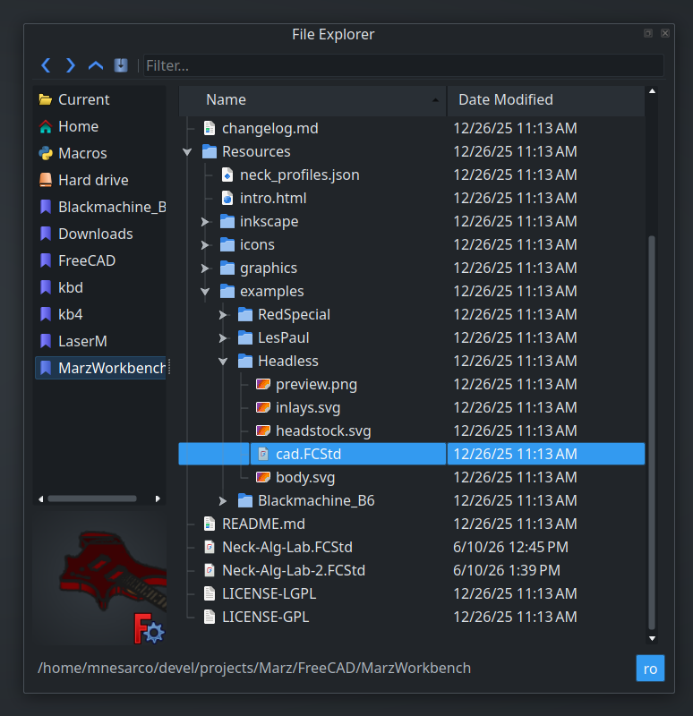

# File Explorer Addon for FreeCAD

This is a small Addon to bring an internal file explorer to FreeCAD with integrated actions.



# Features

- Favorites (named, reorderable, missing folders are marked)
- Open in FreeCAD, import/insert into the current document
- Batch insert of multiple files
- Open in external application
- Show containing folder and open a terminal in the current folder
- Duplicate files, copy/cut/paste with collision confirmation
- Multi-selection and batch actions (trash, delete, duplicate, insert, copy path)
- Filter with matching folders always visible, hidden-files toggle
- Preview panel (images and FreeCAD files) with name, size and modified time
- Move to Trash (system trash) or Delete Permanently, with confirmation
- Protected open documents: trash, delete and rename are blocked for open files and
  folders containing them
- Rename with F2, with collision and invalid-name protection; Recent is updated
- Save the active document, or all open documents, into the current folder
- Dockable, remembers last folder, dock visibility and width
- Drag & Drop with an optional drag lock
- Context menu actions grouped by purpose, destructive actions last
- Execute Macros/Scripts from any directory, install them to the macro folder
- Save/open session file lists (`*.fclist`)
- Synchronized working directory

# Installation

Copy `freecad/FileExplorerExt` into the FreeCAD user `Mod` directory (or install it
through the Addon Manager) and restart FreeCAD.

# Usage

The explorer keeps the last visited folder and restores it on the next start. If that
folder no longer exists it falls back to the folder configured with
**Set as startup folder**, then to the home directory.

## Drag lock

The status bar has a **Lock/Drop** toggle. It starts locked every session.

- **Locked**: dropping files or folders into the tree does nothing. Dragging out of the
  tree still works, to FreeCAD or to the operating system.
- **Unlocked**: dropping a file or folder onto a folder in the tree moves it.

The lock never blocks F2 rename or confirmed menu actions, and dragging out is never
disabled.

## Rename

Press **F2** or use **Rename (F2)** in the context menu. Renaming works in both lock
states. Renames are rejected for empty names, names containing path separators, names
that already exist, and files or folders belonging to an open document.

## Destructive actions

- **Move to Trash** uses the system trash and asks for a light confirmation.
  Restoring or emptying the trash is handled by the operating system.
- **Delete Permanently** is a separate action after a separator and keeps the strong
  warning.
- If the system trash is unavailable or fails, the addon reports the error and offers
  permanent deletion with **No** as the default. It never deletes permanently silently.
- Trashing, deleting or renaming a file of an open document (or a folder containing
  one) is blocked.

## Keyboard shortcuts

| Key | Action |
|---|---|
| Enter | Open the current item |
| Delete | Move selection to Trash |
| Backspace | Go to parent folder |
| F2 | Rename |
| F5 | Refresh |
| Ctrl+F | Focus the filter |
| Escape | Clear the filter |
| Ctrl+C / Ctrl+X / Ctrl+V | Copy / Cut / Paste |

Pasting into a folder where the name already exists asks before overwriting.

## Configuration

Settings are stored as JSON in the FreeCAD user configuration directory:

- Linux: `~/.config/FreeCAD/file_explorer.json`
- Windows: `%APPDATA%\FreeCAD\file_explorer.json`
- macOS: `~/Library/Preferences/FreeCAD/file_explorer.json`

Keys: `last_path`, `default_path`, `favorites`, `dockArea`, `dock_visible`,
`dock_width`, `preview_enabled`, `macro_confirm`. A corrupt file is renamed to
`file_explorer.json.bad` and defaults are used.

## Session lists (.fclist)

**Save open file list (session)** (Ctrl+F3) writes the paths of all open documents to a
`.fclist` file. Opening a `.fclist` reopens the listed files; nested `.fclist` files are
supported and relative paths are resolved against the list file.

## Qt

Qt 6 is the supported target. Qt 5.15+ also provides the trash API used here, but Qt5
is not tested.

# Custom actions

The addon exposes a public API to add context menu entries. See
`freecad/FileExplorerExt/resources/examples/custom_macro.py`:

```python
from freecad.FileExplorerExt import API
from pathlib import Path


def my_actions(paths: list[Path]):
    return [
        API.CustomFileAction(
            text="Example action",
            icon=":/icons/edit_OK.svg",
            activated=lambda paths: print(paths),
        )
    ]


API.add_action_provider(my_actions, key="my-custom-actions")
```

Custom actions receive the full selection list. A failing provider is reported in the
console and does not break the context menu.

# Prerequisite

- Qt6 (Officially supported)
- Qt5 (May work, but officially unsupported)

# Forum

https://forum.freecad.org/viewtopic.php?t=102035

# Custom icons

Based on https://uxwing.com/ free icons.

# Icons based on Bootstrap Icons licensed under MIT License

https://github.com/twbs/icons

# AI Policy

AI generated contributions will be rejected.
